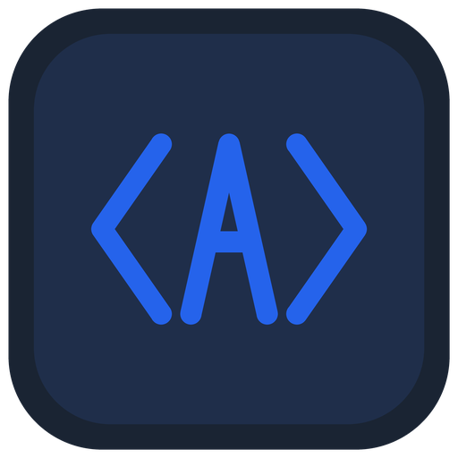

<div align="center">



# AgentsDroid

**专为 Android 设备打造的移动端开源 AI 编程 Agent 工作台。**

让你脱离 PC 电脑，仅凭一台安卓手机即可调度 AI Agent 进行代码审查、编写、Bug 修复、Git 管理及终端命令测试 —— 免 Root 权限，零外部 App 依赖。

[](https://flutter.dev)
[](https://dart.dev)
[](#下载与安装)
[](https://github.com/Aclguh/agentsdroid/releases/latest)
[](LICENSE)

**简体中文** · [English](README_en.md)

</div>

---

## 下载与安装

请前往 [GitHub Releases](https://github.com/Aclguh/agentsdroid/releases/latest) 下载适用于你设备的 Release APK 安装包：

| 安装包名称 | 架构类型 | 文件大小 | 适用说明 |
| :--- | :--- | :--- | :--- |
| `AgentsDroid-arm64-v8a-release.apk` | ARM 64位 (arm64-v8a) | 23.8 MB | 绝大多数现代主流 Android 手机（推荐优先下载） |
| `AgentsDroid-release.apk` | 全架构通用包 (Universal) | 60.8 MB | 整合所有 CPU 架构运行时，兼容全部机型 |
| `AgentsDroid-armeabi-v7a-release.apk` | ARM 32位 (armeabi-v7a) | 21.8 MB | 较旧的 32 位 Android 设备 |
| `AgentsDroid-x86_64-release.apk` | x86_64 架构 | 25.3 MB | 64 位 x86 Android 模拟器或 PC 子系统 |

---

## 核心特性

- **零 Root 权限原则**：完全基于 Android 用户态运行，无需系统提权越狱，更无需安装 Termux 等外部辅助工具。
- **双 Agent 引擎自由切换**：
  - **内置 Dart 原生 Agent 引擎**：开箱即用、毫秒级秒开，直接支持 Anthropic Claude、DeepSeek、Google Gemini、OpenAI 或自定义中转 API。
  - **官方 Claude Code CLI 适配器**：通过在嵌入式 PRoot Debian 沙箱内运行官方原版发布的 `@anthropic-ai/claude-code` 与 Node.js 运行时，拒绝民间魔改版。
- **智能 ANSI 流解析器**：
  - 自动清洗终端控制序列，智能提取思考流、命令执行、Unified Diff 补丁与文件变动。
  - **交互式审批拦截**：将 CLI 终端中的 `[y/n]` 提示无缝拦截并转换为原生审批卡片，点击后自动反哺标准输入。
- **统一原生 GUI 交互**：
  - 智能**工具审批卡片**（支持「单次允许」、「本轮全部放行」、「拒绝」）。
  - 可折叠的**推理思考卡片**（展开可查看 Agent 完整思考过程）。
  - 内置**代码 Diff 审查面板**（清晰高亮新增与删除行，支持行号对比与一键复制新代码）。
  - **工作区生态浏览器**：支持文件管理、新建文件/目录、Git 仓库克隆以及一键导出工作区为 Zip 压缩包。
- **Android 前台保活与 WakeLock**：集成前台通知服务与 CPU 唤醒锁，防止手机锁屏或切换后台时被 Android 系统冻结杀进程。
- **国际化支持 (i18n)**：默认简体中文，支持在设置中一键无缝切换至英文。
- **硬件级安全密钥库**：API Key 通过 Android KeyStore 硬件加密安全持久化。
- **智能分级安全控制**：
  - 只读操作（查看文件、目录列出、文本搜索）自动安全放行。
  - 写文件、打补丁、执行命令等操作弹出原生卡片由用户审批。
  - 为极客与高级用户提供一键开启的完全自主模式 (YOLO Mode)。

---

## 架构概览

```
agentsdroid/
├── lib/
│   ├── core/
│   │   ├── agent/             # Agent 引擎接口与双引擎协调器 (EngineCoordinator)
│   │   ├── builtin/           # BuiltinAgentEngine (LLM 工具调用循环与 Diff 生成)
│   │   ├── cli/               # ClaudeCodeAdapter 与 AnsiStreamParser (终端流转卡片)
│   │   ├── notification/      # ForegroundServiceManager (前台通知与 WakeLock 保活)
│   │   ├── proot/             # PRootManager (Debian-arm64 子系统下载、解压与沙箱执行)
│   │   └── storage/           # KeyVault、WorkspaceService 与 SessionService (会话历史管理)
│   ├── l10n/                  # 国际化本地化资源包 (zh, en)
│   ├── models/                # AgentEvent, ToolCallEvent, DiffEvent, ChatMessage, ChatSession
│   ├── ui/
│   │   ├── chat/              # 主工作台：对话流、引擎切换胶囊、ThoughtCard、ToolApprovalCard
│   │   ├── diff/              # 原生 DiffViewerScreen 变更对比与复制
│   │   ├── explorer/          # WorkspaceExplorerScreen (文件树、Zip 导出与 Git 克隆)
│   │   ├── settings/          # 设置中心：服务商配置、引擎偏好、多语言切换、PRoot 管理
│   │   └── terminal/          # SubsystemTerminalScreen (Debian 终端控制台与工具链状态)
│   └── main.dart              # 应用入口、国际化注入与现代深色主题
└── android/                   # 纯粹的 Android 原生工程、权限声明与前台服务配置
```

---

## 快速上手

### 环境要求
- Flutter SDK 3.47+ / Dart 3.13+
- Android Studio / Android SDK (API 26+)

### 本地开发
```bash
# 获取依赖与生成本地化代码
flutter pub get
flutter gen-l10n

# 运行测试与静态检查
flutter test
flutter analyze

# 启动运行
flutter run
```

### 构建 APK
```bash
flutter build apk --release
```

---

## 开源协议

本项目采用 [MIT License](LICENSE) 开源协议。
